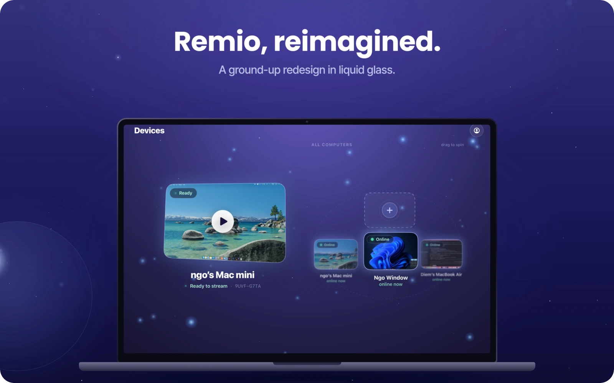
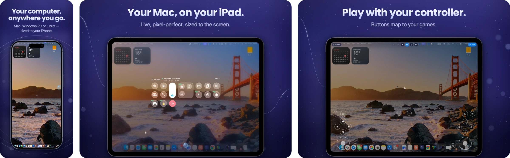

  

<h1 align="center">Remio</h1>

  <b>Control your Mac or PC from any screen.</b> 
  The free, 100% native remote desktop — up to <b>6K at 120 FPS</b>, about <b>8 ms</b> of processing latency on your local network.

  
  
  

  
  
  
  
  

  

| 🎞️ **6K · 120 FPS** | ⚡ **~8 ms** | 🔐 **End to end** | 💸 **$0** |
|:---:|:---:|:---:|:---:|
| hardware H.265, end to end | processing latency on your local network | even the relay only sees ciphertext | no time limit, no ads, no account |

---

## ✨ Why Remio

- **It feels like your machine.** The remote desktop reshapes itself to your screen — live, pixel-perfect — on a virtual display sized exactly to your device, not a squeezed copy of the computer's monitor. Rotate your iPad and it follows.
- **Native, everywhere.** SwiftUI on Apple, Jetpack Compose on Android, C++/WinRT on Windows, C++20 on Linux and FreeBSD. Ten platforms, zero Electron.
- **Connected in seconds.** Scan a QR code or type a six-digit code. No account, no router setup, no IT department.
- **Close the lid. Keep working.** Stream a MacBook with its lid closed — no dummy HDMI dongle, ever — and unlock your computer from wherever you are.
- **Quick on every network.** Direct by default over Wi‑Fi, a cable, 5G or 4G, with an encrypted relay only when your network leaves no other way.
- **Free. Really.** At home or at work — no time limit, no ads, no commercial-use detection, no card.

  

## 🆕 New in Remio 3.3

| Feature | What you get |
|---|---|
| 🖥️ **A second display, anywhere** | Make a phone, tablet or another computer an extra screen for your Mac, Windows PC or Linux computer over any direct connection — across the street, at the office, on mobile data. It never goes through the relay, so it stays as sharp as at home. |
| 🔌 **Plug in a cable** | Connect your iPhone or iPad to your Mac with USB and the session rides the cable: about 1 ms round trip against 3–4 ms on Wi‑Fi. Unplug and it carries on over Wi‑Fi. |
| 🪟 **Every screen, its own window** | Control a computer with several screens and give each one its own window on Mac and Windows — or see them all at once on iPhone and iPad. |
| 🧭 **Follow the pointer** | The view follows your computer's pointer, or the window you're working in, from screen to screen — and the pointer slides onto a tablet you're using as a second display, like a monitor on your desk. |
| 🗣️ **Siri, Spotlight & Shortcuts** | Open any of your computers by asking Siri, from Spotlight, or from a Shortcut on iPhone and iPad. |
| 📸 **Screenshots & View only** | Save the remote screen without Remio's controls around it, or just watch — your mouse, keyboard and controller stay with you. |
| ⌨️ **Type what paste can't reach** | Remio types your clipboard into sign-in screens and apps that block paste. |
| 🎮 **Made for play** | PlayStation motion, touchpad and light bar · the controller you press is player one. |
| ♿ **Narrator & TalkBack** | The Windows and Android apps now work with the system screen reader. |

Every release note, for every app: <a href="https://remio.net/changelog">remio.net/changelog</a>.

## 🧰 Everything at your fingertips

| Area | What's there |
|---|---|
| 👆 **Touch that makes sense** | Trackpad mode or Direct Touch · tap, two-finger right-click, pinch, press-and-drag · three-finger swipes for desktops and Mission Control · Apple Pencil, keyboards and trackpads just work |
| 🎛️ **The Control Board** | Keyboard, zoom, volume, files, apps, displays and settings on one board — drag anything to where your thumb lives |
| 🔊 **Sound & clipboard** | Your computer's audio in sync with the picture · copy on one device, paste on the other — pictures too between Macs |
| 📁 **Files** | Send files straight to your computer — on a Mac, just drop them on the window |
| 🌈 **HDR & 4:4:4** | HDR from a Mac with Apple silicon to HDR screens · full 4:4:4 color for razor-sharp text on Mac and Windows |
| 🙈 **Privacy at the desk** | Blank or lock the computer's screen while you work · Picture in Picture · your session on the Lock Screen and in the Dynamic Island |
| 📱 **Built for iPhone Duo** | Fold it halfway and it's a mini laptop — your computer on top, the keyboard below the hinge |

## 📥 Download

> 💡 **[remio.net/download](https://remio.net/download)** always has the newest build for every platform, with install steps and SHA‑256 checksums.

### 🖥️ Remio Host — on the computer you want to reach

| Platform | Get it | Runs on |
|---|---|---|
| 🍎 **macOS** | [Download the PKG](https://remio.net/download) | macOS 15 Sequoia or later · Apple silicon & Intel |
| 🪟 **Windows** | [Download the installer](https://remio.net/download) · `winget install Remio.RemioHost` | Windows 10 (1809) or later · x64 |
| 🐧 **Linux** | [AppImage · .deb · .rpm · Arch](https://remio.net/download) | Ubuntu 22.04+, Debian 12+, Fedora 36+, Arch and more · X11 or Wayland · x86_64 |
| 🍓 **Raspberry Pi** | [.deb · AppImage](https://remio.net/download) | Raspberry Pi OS Bookworm or newer · 64-bit recommended on Pi 3, 4 and 5 |
| 😈 **FreeBSD** | [pkg](https://remio.net/download) | FreeBSD 14 · amd64 |
| 🤖 **Android** | [APK](https://remio.net/download) | Android 14 or later · phone or tablet |

### 📱 Remio — on the device you control from

| Platform | Get it | Runs on |
|---|---|---|
| 📱 **iPhone & iPad** | [App Store](https://apps.apple.com/app/remio-remote-desktop/id6759306575) | iOS / iPadOS 18 or later |
| 💻 **Mac** | [Mac App Store](https://apps.apple.com/app/remio-remote-desktop/id6759306575) | macOS 15 or later |
| 📺 **Apple TV** | [App Store on Apple TV](https://apps.apple.com/app/remio-remote-desktop/id6759306575) | tvOS 18 or later |
| 🥽 **Apple Vision Pro** | [App Store](https://apps.apple.com/app/remio-remote-desktop/id6759306575) | visionOS |
| 🤖 **Android** | [Google Play](https://play.google.com/store/apps/details?id=com.remio.client) | Android 12 or later |
| 🪟 **Windows** | [Download the installer](https://remio.net/download) · `winget install Remio.RemioClient` | Windows 10 / 11 · x64 |

Apps from the App Store and Google Play update themselves. Remio Host updates itself on Mac and on Windows (or through winget); Linux, Raspberry Pi and FreeBSD packages are on the [download page](https://remio.net/download).

🗂️ Every installer is also attached to a <a href="https://github.com/remioapp/releases/releases">GitHub Release</a>. Tags: <code>vX.Y.Z</code> macOS Host · <code>-win</code> Windows Host and the Windows app · <code>-linux</code> Linux and Raspberry Pi · <code>-freebsd</code> FreeBSD · <code>-android</code> Android Host.

## 🚀 Up and running in a minute

1. **Install Remio Host** on the computer you want to reach.
2. **Open Remio** on your phone, tablet, TV or another computer.
3. **Scan the QR code** — or type the six-digit code. You're in.

No account. No port forwarding. No settings to learn first.

## 🔒 Private by design

- **Encrypted end to end** — video, audio, input, clipboard and files. Even the relay only sees ciphertext.
- **Direct first** — peer-to-peer by default; an encrypted relay only when your network demands it.
- **Your screen stays yours** — no account required, no ads, no data brokers. Your screen content is never logged or inspected.
- **Your call on statistics** — one switch in Settings stops the usage numbers that help us improve Remio. They never include your screen, what you type or your files.

Read the [Security Whitepaper](https://remio.net/security-whitepaper) · report a vulnerability to [security@remio.net](mailto:security@remio.net) ([policy](SECURITY.md)).

## 🔗 Links

[Website](https://remio.net) · [Features](https://remio.net/features) · [Docs](https://remio.net/docs) · [FAQ](https://remio.net/faq) · [Changelog](https://remio.net/changelog) · [Benchmarks](https://remio.net/benchmarks) · [Roadmap](https://remio.net/roadmap) · [Support](mailto:support@remio.net)

---

  Remio is proprietary software — <a href="https://remio.net/terms">Terms of Use</a> · <a href="https://remio.net/privacy">Privacy Policy</a> 
  Made with ❤️ in Vietnam 🇻🇳 — for remote workers, creators and gamers everywhere.

